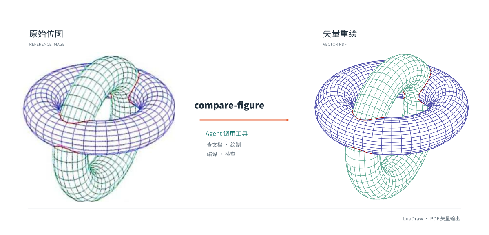

# compare-figure

**用 LuaDraw、LaTeX 或 Asymptote 绘制、重绘和检查高质量矢量插图，交付可编辑的 LaTeX 源码与 PDF。**

可以根据参考图片还原图形，也可以从文字描述创作数学图、几何图、函数图和示意图；支持结合 Markdown 的插图上下文，或为 LaTeX 文稿绘制可嵌入的图稿。内置 LuaDraw／Asymptote 官方文档检索、编译、图片比对与本地会话查看器，帮助完成“查文档 → 绘图 → 编译 → 看图 → 修正”的过程。

## 重绘效果



[查看矢量 PDF](assets/showcase/two-tori.pdf)

## 快速安装

复制给你的 Agent：

```text
请按 https://github.com/ai-npee/compare-figure/blob/main/install.md 安装 compare-figure Skill。
```

手动安装也可直接查看 [安装流程](install.md)。安装完成后，提供参考图或描述想画什么即可。

## 怎么使用

| 想完成的事情 | 可以这样描述 |
|---|---|
| 按图片重绘 | “把这张图用 LuaDraw 重绘，保留标注、比例和线型，给我可编辑 TeX 和 PDF。” |
| 从描述创作 | “画一个椭球与平面相交的三维示意图，标注坐标轴和截面，适合黑白讲义。” |
| 处理 Markdown 插图 | “重绘这份 Markdown 中的指定插图，结合图前后的题意和符号，给出图稿与替换建议。” |
| 为 LaTeX 文稿配图 | “为这段 LaTeX 题目绘制函数与阴影区域图，字体和数学标注与正文一致。” |
| 查询 LuaDraw 用法 | “先检索官方手册和源码示例，确认曲面、箭头和标注的方法，再绘图。” |

绘图库可配置为 **LuaDraw、常规 LaTeX、Asymptote、混合选择** 四种策略；混合模式由模型按图选用，并同时提供两套专用库文档。默认 LuaDraw，详见 [模式配置](docs/drawing-modes.md)。

主要有两种工作方式：

- **当前 Agent 绘图**：直接查文档、写绘图源码、编译、看图和修正，无需额外模型密钥；既可重绘，也可原创。
- **自动绘图**：提供支持图片与工具调用的模型接入，让 runner 自动迭代参考图重绘，保留会话并支持中断续跑。

参考图重绘支持图片及可选的实际尺寸、Markdown 上下文，并提供像素叠图和尺寸偏差检查。使用 `--source-md` 时，默认从 Markdown 图片引用定位原图，并以原图所在目录查看其他图片；Markdown 中其他本地图片链接也可直接查看，`--images-dir` 仅作回退。原创图按描述检查结构、标注与样式，不需要参考图片或比对分数。Markdown／LaTeX 文稿可作为绘图上下文和图稿嵌入目标；当前不是一键转换整篇文稿的工具。

## 能得到什么

- **可编辑图稿**：自动 runner 交付独立可编辑 TeX、所选语言的原始源码、PDF 和预览；当前 Agent 绘图也按此形式整理交付。
- **文档辅助**：检索官方手册和项目补充参考、查看 PDF 页／区域，或读取 TeX／Lua／Asymptote 源文件的指定行；由独立 doc-library 提供检索与高频缓存。默认返回一份正文及来源、页码／行号，区域坐标按 `include_bbox` 开启；启动默认和单次覆盖见 [检索接口](docs/luadraw-doc.md)。可显式选择旧版丰富响应。
- **重绘检查**：结合叠图、物理尺寸和实际图像检查还原效果；分数不能代替内容核对。
- **会话回看**：用 Chrome／Edge 打开 [viewer.html](viewer.html)，选择会话目录，查看工具过程和图片。只读本地目录，按需加载，不上传；手动刷新读取新内容。

## 详细说明

| 内容 | 入口 |
|---|---|
| Skill 行为与完整操作流程 | [SKILL.md](SKILL.md) |
| CLI、尺寸、Markdown 输入、配置、续跑与工具 | [详细使用说明](docs/usage.md) |
| 四绘图库策略与编译交付 | [模式配置](docs/drawing-modes.md) |
| LuaDraw曲面网格、相交面裁切与方法选择 | [曲面渲染参考](docs/luadraw-surface-rendering.md) |
| 完整绘图提示词与复核模板用途 | [提示词说明](docs/prompt-guide.md) |
| 会话查看器与离线公式排版 | [数学语法与代码显示](docs/viewer-math.md) |
| 独立文档工具及旧入口兼容 | [检索接口](docs/luadraw-doc.md) · [功能差异](docs/doc-library-compatibility.md) |
| 原生 Go 接口、构建和资源导出 | [Go 运行说明](docs/go-native.md) |
| CI 检查、版本标签与源码 Skill 发布 | [发布说明](docs/releasing.md) |
| 已验证范围、历史变更和后续计划 | [开发记录](docs/notes.md) |

## 构建与配置

仓库和 Skill 包均只附生产源码，不带预构建程序。首次需要 [Go 1.25+](https://go.dev/dl/)（[安装说明](https://go.dev/doc/install)）；绘图需要 LuaLaTeX，或 Lua/texlua 配合 XeLaTeX/pdfLaTeX，文档与 PDF 操作需要 Poppler。Asymptote 策略另需可用的 `asy`。首次构建按固定版本下载 doc-library 等 Go 依赖；正式程序不依赖 Python。

```bash
git clone https://github.com/ai-npee/compare-figure.git
cd compare-figure
go -C go build -o ../build/compare-figure ./cmd/compare-figure
build/compare-figure environment
build/compare-figure document-search --query Dpolyline3d
```

Windows 构建输出名改为 `../build/compare-figure.exe`。编译结果的实际路径以 JSON 响应为准。

自动 runner 的配置从 [注释示例](examples/runner.yaml.example) 复制，密钥建议通过环境变量传入。运行前先看 [配置发现与字段指南](docs/configuration.md)：已有配置按显式路径、`COMPARE_FIGURE_CONFIG`、当前目录、Skill/resource root 的顺序只选一个；没有配置时才复制示例。`run --check` 可先验证而不调用模型。真实配置、缓存和运行数据不进入源码 Skill 包。当前 Agent 绘图不需要填写这份模型配置。

```bash
cp examples/runner.yaml.example runner.yaml
# 配置模型后，先检查；通过后再去掉 --check 正式启动
build/compare-figure run --original reference.png --out runs/figure-001 --check
build/compare-figure run --original reference.png --out runs/figure-001
# 也可显式关闭文件配置：--config none
# 原创或重绘图稿均可单独编译（compile 不读取 runner 配置）
build/compare-figure compile --source figure.tex --out work/compiled
```

## 开发与发布

```bash
go -C go test ./...
go -C go vet ./...
node scripts/test_viewer.mjs
./scripts/export_skill.sh
```

导出版本取自 [VERSION](VERSION)，生成源码 Skill ZIP、SHA256 和逐文件清单。GitHub Actions 仅在手动触发时运行完整 CI；普通提交、推送和 PR 不自动运行检查。匹配版本的 `vX.Y.Z` 标签会直接校验版本、打包并创建 Release，不再等待完整 CI，详见 [发布说明](docs/releasing.md)。

项目采用 [MIT 许可](LICENSE)，固定 LuaDraw 3.7、Asymptote 3.16 和 viewer 的本地 KaTeX 0.18.2 资源各保留原许可。依赖和提示词来源见 [固定依赖](vendor/dependencies.lock.json) 、[提示词来源](docs/upstream.json) 与 [Asymptote 资源来源](docs/asymptote-upstream.json)。
